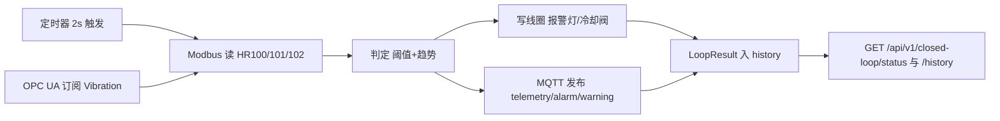

## 用户需求

用户要求更新 `README.md`，使其与当前代码库实际状态保持一致。README 已有大量内容停留在"仅 Modbus 温度读取"阶段，而代码已演进为"Modbus + OPC UA + 闭环控制 + MQTT"的完整链路，需要同步修正。

## 产品概述

工业 AI 数据服务：基于 FastAPI 的工业设备数据采集后端。通过 Modbus TCP 采集现场温/压/振数据并控制线圈（报警灯、冷却阀），通过 OPC UA 订阅产线节点变化，后台闭环采集器按固定周期完成"触发 → 采集 → 判定 → 输出"，对外提供 HTTP API 并以 MQTT 发布遥测与告警。

## 核心特性

- 传感器数据接口：读取产线温度（Modbus 保持寄存器换算）
- 闭环控制：周期采集、阈值与趋势判定、自动执行线圈动作、记录历史
- 闭环查询接口：最新状态与历史判定记录
- OPC UA 客户端订阅与产线节点模拟服务器
- MQTT 遥测/告警发布
- 本地 Modbus 与 OPC UA 模拟器，支持无硬件联调
- 统一响应格式、结构化日志与请求追踪、Docker 一键编排

## 文档更新范围（视觉与内容效果）

仅修改 `README.md` 一个文件，保持现有风格（中文、表格分节、PowerShell 命令块），重写为"同步当前代码"的版本：补充闭环与 OPC UA 章节、闭环 API 端点、新增配置项与四服务 compose 说明，修正技术栈与目录结构，将根目录旧脚本标注为遗留。

## 任务性质

纯文档同步任务，不涉及代码逻辑改动。唯一修改文件：`e:/IndustryAI/industrial-ai-service/README.md`（当前 283 行）。

## 事实来源（须逐项核对后写入，禁止凭空编造）

- `pyproject.toml`：依赖版本与 dev 组、`asyncio_mode="auto"`、`pythonpath=["src"]`、`testpaths=["tests"]`
- `src/app/main.py`：lifespan 启动/关闭顺序、异常处理器、根路由与测试端点
- `src/app/services/collector.py`：闭环周期 `interval=2.0`、阈值 `TEMP_WARNING=30.0` / `TEMP_ALARM=35.0` / `VIB_WARNING=2.5` / `VIB_ALARM=3.5`、趋势判定（近 5 条温差 >1.0）、线圈动作、MQTT 主题 `factory/line1/{telemetry|alarm|warning}`、history `deque(maxlen=100)`
- `src/app/services/opcua_service.py`、`src/app/simulators/*`：端点、命名空间 URI、节点路径、寄存器/线圈布局
- `src/app/core/config.py`：`MODBUS_PORT` 默认 5020、新增 `OPCUA_HOST` / `OPCUA_PORT` / `OPCUA_NS_URI`
- `docker-compose.yml`、`Dockerfile`：四服务编排、健康检查位置、启动 CMD
- `tests/`：`conftest.py` 的 `FakeModbusService` + 依赖覆盖，`test_closed_loop.py` 的 `FakeModbus` / `FakeOpcUa`

## 闭环数据流（文档图示）

## 实现要点

- 保留现有章节骨架与表达习惯，做"定点重写"而非全文推翻，降低阅读者适应成本
- 旧脚本 `modbus_sim.py` / `write_register.py` 保留说明但标注为"遗留脚本，已被 `src/app/simulators` 取代"
- 明确标注仍为空文件/规划中的部分：`src/app/api/routes/device.py`、`src/app/services/mqtt_service.py`（当前 MQTT 逻辑内联在 `collector.py`）
- 提示 `.env.example` 尚未包含 `OPCUA_*` 且 `MODBUS_PORT` 仍为 502，需手动补齐（本次不改该文件）
- 不删除 Dockerfile 的 Python 3.14 一致性与 `--no-install-project` 说明，但需修正"HEALTHCHECK 已在 Dockerfile 中启用""oitc/modbus-server 镜像"等过时表述