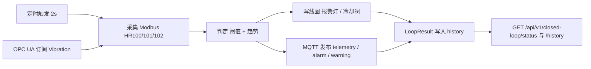
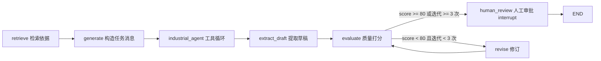

# industrial-ai-service

工业 AI 数据服务 —— 基于 FastAPI 的工业设备数据采集与闭环控制后端，内置基于 LangGraph 的文档评审 Agent。

- **采集**：通过 Modbus TCP 读取现场设备的温度、压力、振动，并通过 OPC UA 订阅产线节点变化
- **闭环**：后台采集器按固定周期执行「触发 → 采集 → 判定 → 输出」，超阈值时自动写线圈（报警灯 / 冷却阀）并向 MQTT 发布告警
- **评审**：LangGraph 文档评审 Agent 走「检索 → 生成 → 工具调用 → 质量评估 → 人工审批」链路，实时传感数据由工具读取，高危工具（`trigger_alarm`）与最终结论均需人工授权/审批后才落地
- **对外**：统一的 HTTP API（最新状态、历史判定记录、Agent 评审的启动/恢复/状态查询）+ MQTT 遥测/告警主题，为上层 AI 分析与工业应用提供数据接入
- **联调**：内置 Modbus TCP 与 OPC UA 模拟器，无需真实硬件即可完整跑通链路

## 技术栈

| 组件 | 说明 |
| --- | --- |
| Python | >= 3.14 |
| FastAPI | Web 框架（应用工厂 + lifespan 生命周期管理） |
| Pydantic v2 / pydantic-settings | 请求/响应模型校验与配置管理 |
| pymodbus 3.6.9 | Modbus TCP 异步客户端与服务端（模拟器） |
| asyncua | OPC UA 客户端（订阅节点变化）与服务端（模拟器） |
| paho-mqtt | MQTT 发布：遥测 telemetry、告警 alarm、预警 warning |
| LangChain / LangGraph | Agent 图编排（`StateGraph`、`create_agent`）、`HumanInTheLoopMiddleware` 工具级中断、checkpoint 暂停与恢复 |
| qwen-plus（DashScope） | LLM，通过阿里云百炼的 OpenAI 兼容模式调用（`langchain-openai`） |
| uvicorn | ASGI 服务器 |
| uv | 包管理与项目构建 |
| Docker / Docker Compose | 容器化构建与一键编排（API + Modbus 模拟 + OPC UA 模拟 + Mosquitto） |

开发依赖（dev 组）：`pytest`、`pytest-asyncio`、`pytest-cov`、`httpx`（异步 API 测试客户端）、`ruff`（代码检查）。

## 目录结构

```
industrial-ai-service/
├── src/
│   ├── app/
│   │   ├── agents/
│   │   │   ├── state.py             # ReviewState：评审状态字段（document_text、draft_review、quality_score…）
│   │   │   ├── graph.py             # build_graph() 七节点 StateGraph；build_industrial_agent() 工具 Agent + 人工授权
│   │   │   ├── nodes.py             # 节点：retrieve / generate / extract_draft / evaluate / revise / human_review
│   │   │   ├── routing.py           # route_after_evaluate：质量分与迭代上限决定转人工还是继续修订
│   │   │   ├── tools.py             # INDUSTRIAL_TOOLS：read_sensor_data、query_equipment_manual、trigger_alarm
│   │   │   ├── llm.py               # LLM 初始化：qwen-plus + DashScope OpenAI 兼容端点
│   │   │   ├── interrupt_handler.py # 中断提取（review / tool）与 resume 决策值构造
│   │   │   ├── agent.py             # 遗留草稿路由，未被 router.py 引用，勿当作有效接口
│   │   │   └── tests/               # 手动验证脚本：图结构、中断、工具调用与审批恢复（非 pytest 用例）
│   │   ├── api/
│   │   │   ├── routes/
│   │   │   │   ├── sensor.py        # 传感器数据接口：GET /api/v1/sensor/temperature
│   │   │   │   ├── closed_loop.py   # 闭环接口：GET /api/v1/closed-loop/status、/history
│   │   │   │   ├── agent.py         # 评审接口：POST /agent/review、/resume，GET /agent/review/{thread_id}/status
│   │   │   │   ├── health.py        # 健康检查：GET /api/v1/health
│   │   │   │   └── device.py        # 设备控制接口（空文件，规划中）
│   │   │   └── router.py            # 路由汇总，挂载 sensor / health / closed_loop / agent
│   │   ├── core/
│   │   │   ├── config.py            # 配置管理：pydantic-settings 加载 .env，lru_cache 单例
│   │   │   ├── logging.py           # 日志配置：JSON 结构化日志，附带 request_id 与异常信息
│   │   │   ├── exceptions.py        # 自定义异常：AppException 基类、DeviceOfflineError、InvalidParameterError
│   │   │   └── middleware.py         # RequestIdMiddleware：生成/透传 X-Request-ID，记录请求日志
│   │   ├── schemas/
│   │   │   ├── sensor.py            # Pydantic 模型：SensorReading、DeviceCommand
│   │   │   ├── closed_loop.py       # 闭环结果模型：LoopResult
│   │   │   └── common.py            # 通用响应模型：APIResponse{code, msg, data}
│   │   ├── services/
│   │   │   ├── modbus_service.py    # Modbus 读写：连接管理、读保持寄存器、读写线圈
│   │   │   ├── collector.py         # 闭环采集器 ClosedLoopCollector：采集 → 判定 → 输出
│   │   │   ├── opcua_service.py     # OPC UA 客户端：连接、订阅节点变化、读值
│   │   │   ├── verify_opcua_subscribe.py  # 独立脚本：验证 OPC UA 订阅是否收到变化
│   │   │   └── mqtt_service.py      # MQTT 发布逻辑（空文件，规划中）
│   │   ├── dependencies/
│   │   │   └── providers.py         # 依赖注入提供者：get_modbus_service() 单例工厂
│   │   ├── simulators/
│   │   │   ├── modbus_simulator.py  # Modbus TCP 从站模拟器（数值自动变化）
│   │   │   └── opcua_server.py      # OPC UA 服务器模拟器（产线节点树）
│   │   └── main.py                  # 应用工厂入口：create_app()、lifespan、统一异常处理器
│   └── industrial_ai_service/       # uv 构建的包入口（industrial-ai-service 命令）
├── tests/
│   ├── conftest.py                  # pytest fixtures：FakeModbusService 伪造服务 + httpx AsyncClient
│   ├── test_sensor.py               # 传感器接口测试：正常读取、参数校验、设备离线等用例
│   └── test_closed_loop.py          # 闭环测试：FakeModbus / FakeOpcUa 下的判定与线圈动作
├── front/                           # 前端工程（Vue 3 + Vite + Element Plus，详见 front/README.md）
├── modbus_sim.py                    # 遗留脚本：早期 Modbus 模拟器（见下文）
├── write_register.py                # 遗留脚本：向模拟器寄存器写入值（见下文）
├── Dockerfile                       # 多阶段构建镜像：uv 构建依赖 + 非 root 用户运行
├── docker-compose.yml               # 编排 API、Modbus 模拟、OPC UA 模拟、Mosquitto
├── pyproject.toml                   # 项目元数据、依赖与 pytest 配置（uv）
├── uv.lock                          # 依赖锁定文件
└── .env.example                     # 环境变量模板
```

> `src/app/api/routes/device.py` 与 `src/app/services/mqtt_service.py` 目前为空文件；MQTT 发布逻辑内联在 `collector.py` 中。

## 核心设计

### 应用工厂与生命周期

`src/app/main.py` 使用 `create_app()` 工厂函数创建 FastAPI 实例，`lifespan` 负责启动与关闭整套运行时：

启动：

1. `get_modbus_service()` 获取单例并 `connect()`，连接失败抛出 `DeviceOfflineError`
2. 创建 `OpcUaService`（`opc.tcp://{OPCUA_HOST}:{OPCUA_PORT}/freeopcua/server/`）
3. 创建 `ClosedLoopCollector` 并 `start()`，实例挂到 `app.state.collector`
4. 降低 `asyncua` 日志级别为 WARNING，避免订阅回调刷屏
5. 创建 `InMemorySaver()` 作为 checkpointer，`build_graph(checkpointer)` 编译后的图挂到 `app.state.agent`（开发态内存存储，进程重启即丢失；生产可换 `AsyncPostgresSaver`）

关闭：`collector.stop()` → `modbus.disconnect()`

### 依赖注入

`src/app/dependencies/providers.py` 中的 `get_modbus_service()` 使用 `lru_cache` 缓存 `ModbusService` 实例，配置来源于 `get_settings()`（同样单例），路由通过 `Depends` 注入服务。

### 统一响应与异常处理

- 成功响应：`APIResponse{code: 0, msg: "success", data: ...}`
- `AppException` 及其子类：返回对应的 `status_code` 与 `{code, message, data}` 结构
- 参数校验失败（`RequestValidationError`）：返回 `422 VALIDATION_ERROR`
- 未预期异常：返回 `500 INTERNAL_ERROR`

内置异常类型（`src/app/core/exceptions.py`）：

| 异常 | code | HTTP 状态码 |
| --- | --- | --- |
| `DeviceOfflineError` | `DEVICE_OFFLINE` | 503 |
| `InvalidParameterError` | `INVALID_PARAMETER` | 400 |
| `ModbusService` 通信异常 | `MODBUS_ERROR` / `MODBUS_READ_ERROR` / `MODBUS_WRITE_ERROR` | 502 |

### 结构化日志与请求追踪

- `src/app/core/logging.py`：JSON 格式日志（时间戳、级别、logger、消息、模块、行号），异常时附带堆栈
- `src/app/core/middleware.py`：每个请求生成 `X-Request-ID`（优先复用请求头中的值），写入 `request.state`、响应头，并注入每条日志，便于全链路问题定位

### Modbus 服务

`src/app/services/modbus_service.py` 基于 `AsyncModbusTcpClient`，从站 ID 由 `MODBUS_SLAVE_ID` 决定（默认 1）：

| 类型 | 地址 | 含义 | 换算 |
| --- | --- | --- | --- |
| 保持寄存器 HR | 100 | 温度 | 值 / 10（250 → 25.0 °C） |
| 保持寄存器 HR | 101 | 压力 | 值 / 10（1013 → 101.3 kPa） |
| 保持寄存器 HR | 102 | 振动 | 值 / 100（150 → 1.50 mm/s） |
| 线圈 CO | 0 | 报警灯 | `True` 亮 |
| 线圈 CO | 1 | 冷却阀 | `True` 开 |

- `read_temperature(line_id)`：读 1 个寄存器（地址 100），供传感器接口使用
- `read_sensor_data()`：一次读 3 个寄存器（100~102），返回温/压/振，供闭环使用
- `write_coil()` / `read_coils()`：写单个线圈 / 读线圈 0~1 状态
- 连接异常映射为 `DeviceOfflineError(503)`，协议异常映射为 `MODBUS_ERROR(502)`

### OPC UA 服务

`src/app/services/opcua_service.py` 基于 `asyncua`：

- `connect()`：建立连接后动态解析命名空间索引（按 `OPCUA_NS_URI` 在 namespace array 中查找，避免写死）
- `subscribe(paths, on_change)`：创建订阅（发布间隔 500 ms），节点 ID 形式为 `ns={idx};s={path}`
- `read_value(path)`：直接读取节点值
- 变化通过 `OpcUaSubHandler.datachange_notification` 回调，以节点 Identifier 为 key 缓存最新值

### 闭环采集器

`src/app/services/collector.py` 的 `ClosedLoopCollector` 是常驻后台任务，每 `interval`（默认 2.0 秒）执行一次完整闭环：



**判定规则**（`_judge`）：

| 等级 severity | 触发条件 | 动作 action_taken |
| --- | --- | --- |
| `alarm` | 温度 ≥ 35.0 °C 或 振动 ≥ 3.5 mm/s | 报警灯亮 + 冷却阀开 |
| `warning` | 温度 ≥ 30.0 °C 或 振动 ≥ 2.5 mm/s | 冷却阀开 |
| `normal` | 均低于预警阈值 | 无（两个线圈置 False） |

趋势 `trend`：取最近 5 条历史温度，首尾差 > 1.0 为 `rising`，< -1.0 为 `falling`，否则 `stable`（历史不足 5 条时为 `stable`）。

**输出**：

- 线圈：`ALARM_COIL = 0`、`COOLING_COIL = 1`，按上表写入后回读状态写入结果
- MQTT：主题 `{MQTT_TOPIC_PREFIX}/line1/{channel}`，channel 取值 `telemetry`（每轮必发）、`alarm`、`warning`；QoS = 1
- 历史：`deque(maxlen=100)` 保留最近 100 条 `LoopResult`，`latest` 保存最新一条

`LoopResult` 字段（`src/app/schemas/closed_loop.py`）：

| 字段 | 说明 |
| --- | --- |
| `timestamp` | 判定时间 |
| `temperature` / `pressure` / `vibration` | 采集值（°C / kPa / mm/s） |
| `severity` | `normal` / `warning` / `alarm` |
| `trend` | `stable` / `rising` / `falling` |
| `message` | 判定说明文本 |
| `action_taken` | 已执行动作 |
| `modbus_coils` | `{alarm_light, cooling_valve}` 回读的线圈状态 |

启动细节：OPC UA 连接最多重试 10 次（每次间隔 2 秒）以等待模拟服务器就绪，仍失败则抛 `RuntimeError`；MQTT 连接失败仅记录告警，不影响闭环继续运行。

> 振动取值优先使用 OPC UA 订阅值（`ProductionLine/Vibration`），未收到订阅数据时回退为 Modbus HR[102] 的值。

### 文档评审 Agent（LangGraph）

`src/app/agents/` 是一个基于 LangGraph 的工业文档评审 Agent：除了调用 LLM 生成评审意见，还会调用工业工具读取实时传感数据、检索规范，并把高危动作与最终结论交回人工决策。

**图结构**（`build_graph(checkpointer)` 注册七个节点）：



- `industrial_agent` 由 `create_agent` + `HumanInTheLoopMiddleware` 组合而成，内部自行完成多轮工具调用，输出写入 `messages`
- `extract_draft_node` 从 `messages` 中取最后一条 assistant 内容搬进 `draft_review`（`create_agent` 只更新 `messages`）
- `evaluate_node` 当前用「草稿长度 > 100 → 85 分，否则 60 分」模拟打分，每次进入 `revision_count + 1`；`revise_node` 调 `llm.ainvoke` 按 `missing_info` 改写草稿

**`ReviewState` 字段**（`src/app/agents/state.py`）：

| 字段 | 说明 |
| --- | --- |
| `messages` | 对话历史（含 tool_calls），`Annotated[list, add_messages]` |
| `document_text` | 待评审文档原文，由 API 入口写入 |
| `retrieved_chunks` | 检索召回的依据块（当前为模拟数据） |
| `draft_review` | LLM 生成的评审意见草稿，`revise` 会覆盖 |
| `quality_score` | 质量分 0~100，由 `evaluate` 写入 |
| `missing_info` | 缺失信息点，供 `revise` 作为修订指令 |
| `revision_count` | 已修订次数，硬上限 3（防 LLM 无限自我修正） |
| `human_decision` | `pending` / `approved` / `rejected` |
| `final_output` | 最终评审意见（可能被人工编辑） |

**评估后路由**（`route_after_evaluate`）：

| 条件 | 去向 |
| --- | --- |
| `quality_score >= 80` | `human_review` |
| `revision_count >= 3` | `human_review`（断路器，强制转人工） |
| 其余 | `revise` → 回到 `evaluate` |

**工业工具**（`src/app/agents/tools.py`，`INDUSTRIAL_TOOLS`）：

| 工具 | 行为 | 是否需要人工授权 |
| --- | --- | --- |
| `read_sensor_data(line_id)` | 复用 `get_modbus_service().read_sensor_data()` 读温度/压力/振动 | 否（`interrupt_on=False`） |
| `query_equipment_manual(query)` | 检索设备手册、工艺规范、质检标准（当前返回占位文本，待接真实 RAG） | 否 |
| `trigger_alarm(line_id, reason)` | 高危：写线圈 0（报警灯）与 1（冷却阀）为 `True` | 是（`interrupt_on=True`） |

`generate_node` 的 prompt 内置 7 条强制规则，核心是「数值以 `read_sensor_data` 实测为准」：禁止把文档或用户描述中的数值当事实；仅当实测温度 > 35.0 °C 或振动 > 3.5 mm/s 才允许调用 `trigger_alarm`；`reason` 必须写明实际读数；读数失败时禁止报警，改为建议人工核查。

**两类中断与 resume 动作**（`src/app/agents/interrupt_handler.py`）：

| kind | 触发位置 | payload 特征 | resume 值 |
| --- | --- | --- | --- |
| `review` | `human_review_node` 中的 `interrupt()` | 含 `draft_review` / `quality_score` / `question` | `{"action": "approve"}`、`{"action": "edit", "edited_text": ...}`、`{"action": "reject"}` |
| `tool` | `HumanInTheLoopMiddleware`（batched 模式） | 含 `action_requests` | `{"decisions": [{"type": "approve"} ...]}` 或 `{"decisions": [{"type": "reject", "message": ...}]}` |

> `decisions` 的数量必须与挂起的 `action_requests` 数量一致，服务端通过 `_count_pending_tool_requests()` 从 checkpoint 统计；数量不匹配会导致 `Command(resume=...)` 恢复失败。

**会话与状态约定**：

- `thread_id` 由 `/agent/review` 生成（`review_` + 12 位 hex），恢复与查询必须复用同一个 `thread_id`，否则会加载到空状态
- resume 后可能再次中断（工具循环或评审循环），响应中 `interrupted=true` 并返回新的 `interrupts`，调用方需循环渲染审批卡直至完结
- 响应前经 `_serialize_state()` 处理：剔除 `__interrupt__`，并把 `messages` 里的 LangChain Message 转为 `{type, content}`，保证可 JSON 序列化
- checkpointer 决定中断状态能否持久化：`lifespan` 注入 `InMemorySaver()`（进程重启即丢失），生产可换 `AsyncPostgresSaver`
- `src/app/agents/agent.py` 是早期草稿路由，未被 `router.py` 引用，**不是有效接口**

## 本地模拟器

在没有真实 PLC/传感器的环境下，使用 `src/app/simulators/` 下的两个模拟器进行联调。

### Modbus TCP 模拟器

`src/app/simulators/modbus_simulator.py`：

- 监听 `0.0.0.0:5020`，从站 ID `1`，`zero_mode=True`（客户端地址直接映射数据块索引）
- 初始寄存器：HR[100] = 250（25.0 °C）、HR[101] = 1013（101.3 kPa）、HR[102] = 150（1.50 mm/s）
- 后台任务每 2 秒随机游走更新：温度 20.0~40.0 °C、压力随温度联动、振动 0.5~4.0 mm/s
- 线圈 CO[0] 报警灯、CO[1] 冷却阀，供闭环写入

```powershell
uv run python -m app.simulators.modbus_simulator
# 输出: Modbus 从站启动，监听 0.0.0.0:5020，从站 ID=1
```

> 若提示找不到 `app` 包，先设置 `$env:PYTHONPATH = "src"` 再运行（Docker 中已通过 `PYTHONPATH=/app/src` 设置）。

### OPC UA 服务器模拟器

`src/app/simulators/opcua_server.py`：

- 端点 `opc.tcp://0.0.0.0:4840/freeopcua/server/`，命名空间 URI `http://my.factory.namespace`
- 节点树 `Objects → ProductionLine`：`Temperature`（°C）、`Pressure`（kPa）、`Vibration`（mm/s）、`Status`（String）
- 每 2 秒更新节点值（同样的随机游走规律），订阅端可实时收到变化

```powershell
uv run python -m app.simulators.opcua_server
# 输出: OPC UA 服务器已启动，监听 opc.tcp://0.0.0.0:4840
```

### 验证 OPC UA 订阅

`src/app/services/verify_opcua_subscribe.py` 是一个独立验证脚本：连接后先直读一次温度节点，再订阅温度与振动节点，等待 15 秒打印收到的变化。需先启动 OPC UA 模拟器：

```powershell
# 需保证 src 在模块搜索路径（uv sync 已安装项目，或先设置 $env:PYTHONPATH = "src"）
uv run python -m app.services.verify_opcua_subscribe
```

### 遗留脚本

根目录的 `modbus_sim.py`（同步版 Modbus 服务端，仅 HR[100] = 250）与 `write_register.py`（向 `localhost:5020` 从站 1 的地址 100 写入 250）是早期调试脚本，**功能已被 `src/app/simulators` 取代，仅作参考**，新开发请直接使用上面的模拟器。

## 快速开始

### 1. 安装依赖

```powershell
uv sync
```

### 2. 配置环境变量

```powershell
Copy-Item .env.example .env
```

参考配置（本地联调）：

```ini
APP_ENV=development
APP_LOG_LEVEL=INFO
MODBUS_HOST=localhost
MODBUS_PORT=5020
MODBUS_SLAVE_ID=1
OPCUA_HOST=localhost
OPCUA_PORT=4840
OPCUA_NS_URI=http://my.factory.namespace
MQTT_BROKER=localhost
MQTT_PORT=1883
MQTT_TOPIC_PREFIX=factory
DASHSCOPE_API_KEY=sk-xxxxxxxx
```

> `.env.example` 已改为 `MODBUS_PORT=5020` 并包含 `DASHSCOPE_API_KEY` 条目，但**未包含 `OPCUA_*`**，复制后需按上面内容补齐。`MODBUS_PORT` 的代码默认值为 5020（真实设备常见端口为 502，接真机时按需改回）。`DASHSCOPE_API_KEY` 需替换为你在阿里云百炼控制台申请的 Key，否则 Agent 的 LLM 调用会失败。

### 3. 启动模拟器

需要两个终端（OPC UA 模拟器必须启动，否则闭环采集器会在重试 10 次后启动失败）：

```powershell
uv run python -m app.simulators.modbus_simulator
```

```powershell
uv run python -m app.simulators.opcua_server
```

### 4. 启动服务

另开一个终端：

```powershell
uv run uvicorn app.main:app --reload --app-dir src
```

服务默认监听 `http://localhost:8000`，交互式 API 文档位于 `http://localhost:8000/docs`。

### 5. 验证

读取温度：

```powershell
curl "http://localhost:8000/api/v1/sensor/temperature?line_id=line1"
```

```json
{
  "code": 0,
  "msg": "success",
  "data": {
    "line_id": "line1",
    "temperature": 25.0,
    "unit": "celsius",
    "raw_value": 250
  }
}
```

查看闭环最新状态：

```powershell
curl "http://localhost:8000/api/v1/closed-loop/status"
```

```json
{
  "code": 0,
  "msg": "success",
  "data": {
    "timestamp": "2026-10-27T10:00:00",
    "temperature": 25.3,
    "pressure": 101.4,
    "vibration": 1.52,
    "severity": "normal",
    "trend": "stable",
    "message": "参数正常",
    "action_taken": "无",
    "modbus_coils": { "alarm_light": false, "cooling_valve": false }
  }
}
```

查看最近 20 条判定记录：

```powershell
curl "http://localhost:8000/api/v1/closed-loop/history?limit=20"
```

启动一次文档评审（需要 `.env` 中已配置可用的 `DASHSCOPE_API_KEY`）：

```powershell
curl -X POST "http://localhost:8000/api/v1/agent/review" `
  -H "Content-Type: application/json" `
  -d '{"document_text":"本次焊接作业温度偏高，请评估是否需要报警。"}'
```

Agent 通常在工具授权或评审审批处中断，响应形如：

```json
{
  "code": 0,
  "msg": "success",
  "data": {
    "thread_id": "review_1a2b3c4d5e6f",
    "interrupted": true,
    "interrupts": [
      {
        "interrupt_id": "...",
        "kind": "tool",
        "payload": { "action_requests": [{ "name": "trigger_alarm", "args": {} }] }
      }
    ]
  }
}
```

按 `kind` 用同一个 `thread_id` 恢复：工具级中断传 `tool_allow` / `tool_deny`，评审审批传 `approve` / `edit` / `reject`。

```powershell
curl -X POST "http://localhost:8000/api/v1/agent/review/review_1a2b3c4d5e6f/resume" `
  -H "Content-Type: application/json" `
  -d '{"action":"tool_allow"}'
```

## 运行测试

测试使用 `pytest` + `httpx` 的 `ASGITransport` 直接调用 ASGI 应用，闭环用例则直接实例化 `ClosedLoopCollector` 并注入伪造服务，因此**无需启动模拟器或真实设备**。

- `tests/conftest.py`：`FakeModbusService` 伪造实现（可调温度值、可强制失败），`app` fixture 中通过 `app.dependency_overrides[get_modbus_service]` 替换，`client` fixture 提供 `AsyncClient`
- `tests/test_sensor.py`：覆盖成功读取、非法 `line_id`、缺少参数（均返回 422 `VALIDATION_ERROR`）、设备离线（503 `DEVICE_OFFLINE`）
- `tests/test_closed_loop.py`：`FakeModbus` + `FakeOpcUa` 下验证 `normal` / `alarm` 判定，以及报警时线圈 0、1 均被置 `True`
- `src/app/agents/tests/`：8 个**手动验证脚本**（非 pytest 用例），覆盖图结构与 revise 循环、中断提取、approve / reject 恢复、多工具循环、只读工具不触发中断、`trigger_alarm` 中断与工具构造

> 上述脚本没有 `test_*` 断言函数，每个文件自带 `asyncio.run(main())` 入口（`test_graph.py` 甚至在模块级直接执行），依赖 `DASHSCOPE_API_KEY` 与已启动的 Modbus 模拟器，**默认不会被 `uv run pytest` 收集**，需按下文单独运行。

`pyproject.toml` 中已配置 `asyncio_mode = "auto"`、`pythonpath = ["src"]`、`testpaths = ["tests"]`，直接运行即可：

```powershell
uv run pytest              # 运行全部测试
uv run pytest -v           # 显示详细用例
uv run pytest --cov=app    # 带覆盖率报告（pytest-cov）
```

Agent 侧脚本需手动执行（先启动 Modbus 模拟器，并保证 `src` 在模块路径中）：

```powershell
$env:PYTHONPATH = "src"
uv run python src/app/agents/tests/test_check_approve_resume.py
```

## Docker 部署

### 单独构建镜像

`Dockerfile` 采用多阶段构建：

1. `builder` 阶段：`ghcr.io/astral-sh/uv:python3.14-bookworm-slim`，按 `uv.lock` 冻结安装依赖
2. 运行阶段：`python:3.14-slim`，仅拷贝 `.venv` 与 `src/`
3. 创建非 root 用户 `appuser`（uid 10001）运行，`EXPOSE 8000`，`CMD ["uvicorn", "app.main:app", "--host", "0.0.0.0", "--port", "8000", "--app-dir", "src"]`

命令与参数说明：

```dockerfile
RUN uv sync --frozen --no-dev --no-install-project
```

| 参数 | 作用 |
| --- | --- |
| `--frozen` | 严格按 `uv.lock` 安装，与 `pyproject.toml` 不一致时报错，不重新解析依赖 |
| `--no-dev` | 不安装 dev 依赖组（pytest、ruff 等） |
| `--no-install-project` | 只装第三方依赖；本阶段没有 `src/`，否则 uv 构建 editable 根包时报 `Expected a Python module at: src/industrial_ai_service/__init__.py`。应用通过 `uvicorn --app-dir src` 直接导入 `app` 包运行，无需安装 |

> 两个阶段必须统一使用 **Python 3.14**：`uv.lock` 已锁定 `requires-python = ">=3.14"`，使用 Python 3.12 镜像时 `uv sync` 会直接以 exit code 2 失败。
>
> `Dockerfile` 中的 `HEALTHCHECK` 当前为注释状态，健康检查由 `docker-compose.yml` 定义。

```powershell
docker build -t industrial-ai-service .
docker run -p 8000:8000 -e MODBUS_HOST=host.docker.internal -e MODBUS_PORT=5020 industrial-ai-service
```

### docker-compose 一键启动

`docker-compose.yml` 编排四个服务：

| 服务 | 说明 |
| --- | --- |
| `api` | 由当前目录 `Dockerfile` 构建，映射 `8000:8000`；环境变量 `APP_ENV=production`、`MODBUS_HOST=modbus-sim`、`MODBUS_PORT=5020`、`MODBUS_SLAVE_ID=1`、`OPCUA_HOST=opcua-sim`、`OPCUA_PORT=4840`、`MQTT_BROKER=mosquitto`、`MQTT_PORT=1883`；healthcheck 探测 `/api/v1/health`；`depends_on` 其余三个服务 |
| `modbus-sim` | 同镜像，`command: python -m app.simulators.modbus_simulator`，`PYTHONPATH=/app/src`，映射 `5020:5020` |
| `opcua-sim` | 同镜像，`command: python -m app.simulators.opcua_server`，`PYTHONPATH=/app/src`，映射 `4840:4840` |
| `mosquitto` | `eclipse-mosquitto:1.6` 镜像，映射 `1883:1883` |

```powershell
docker compose up --build
curl "http://localhost:8000/api/v1/closed-loop/status"
```

> `api` 与各模拟器之间通过 compose 网络直连，走容器**实际监听端口**；`ports` 映射仅用于宿主机访问。
> 本地调试时，容器内访问宿主机上的模拟器可用 `host.docker.internal`。
> `api` 服务目前**没有声明 `DASHSCOPE_API_KEY`**，要用 Agent 评审需自行补充（compose 的 `environment` 或 `.env` 注入），否则 LLM 调用失败。

## API 端点

| 方法 | 路径 | 说明 |
| --- | --- | --- |
| GET | `/health` | 根健康检查，返回 Hello World |
| GET | `/api/v1/health` | 健康检查，附带 Modbus 连接状态 |
| GET | `/api/v1/sensor/temperature?line_id=line[1-9]` | 读取产线温度（line_id 需匹配 `line1`~`line9`） |
| GET | `/api/v1/closed-loop/status` | 闭环最新判定结果（采集器未产出时返回提示消息） |
| GET | `/api/v1/closed-loop/history?limit=20` | 最近 N 条闭环判定记录（最多 100 条） |
| POST | `/api/v1/agent/review` | 启动文档评审，body `{document_text}`；返回 `thread_id` 与 `interrupts`（可能为空即已完成） |
| POST | `/api/v1/agent/review/{thread_id}/resume` | 恢复中断，body `{action, edited_text?}`；`action` ∈ `approve` / `edit` / `reject` / `tool_allow` / `tool_deny`，`edit` 必须带 `edited_text` |
| GET | `/api/v1/agent/review/{thread_id}/status` | 查询评审状态：`interrupted` / `completed`，`thread_id` 不存在时返回 404 |
| GET | `/test/business-error` | 测试端点：触发业务异常（`DEVICE_OFFLINE`，503） |
| GET | `/test/unknown-error` | 测试端点：触发未预期异常（`INTERNAL_ERROR`，500） |

## 配置项说明

配置通过 `.env` 文件加载（参见 `.env.example`），大小写敏感：

| 变量 | 默认值 | 说明 |
| --- | --- | --- |
| `APP_NAME` | `industrial-ai-service` | 应用名称 |
| `APP_ENV` | `development` | 运行环境 |
| `APP_LOG_LEVEL` | `INFO` | 日志级别 |
| `APP_HOST` | `0.0.0.0` | 服务监听地址 |
| `APP_PORT` | `8000` | 服务监听端口 |
| `MODBUS_HOST` | `localhost` | Modbus TCP 设备地址 |
| `MODBUS_PORT` | `5020` | Modbus TCP 端口（真实设备常见为 502） |
| `MODBUS_SLAVE_ID` | `1` | Modbus 从站 ID |
| `MODBUS_TIMEOUT` | `3.0` | Modbus 通信超时（秒） |
| `OPCUA_HOST` | `localhost` | OPC UA 服务器地址 |
| `OPCUA_PORT` | `4840` | OPC UA 端口 |
| `OPCUA_NS_URI` | `http://my.factory.namespace` | OPC UA 命名空间 URI，用于解析 ns 索引 |
| `MQTT_BROKER` | `localhost` | MQTT Broker 地址 |
| `MQTT_PORT` | `1883` | MQTT 端口 |
| `MQTT_TOPIC_PREFIX` | `factory` | MQTT 主题前缀，实际主题为 `{prefix}/line1/{channel}` |
| `DASHSCOPE_API_KEY` | 无（必填） | 阿里云百炼 API Key。由 `src/app/agents/llm.py` 用 `os.getenv` 直接读取，**不经过 `core/config.py` 的 settings 类**，缺失时 LLM 调用失败 |

## 路线图

- [x] 单元测试（`tests/`，含 FakeModbusService 与依赖注入覆盖、闭环判定测试）
- [x] Docker 容器化（`Dockerfile` 多阶段构建 + `docker-compose.yml` 编排）
- [x] OPC UA 客户端订阅与产线节点模拟服务器
- [x] 闭环采集器与查询接口（采集 → 判定 → 线圈动作 → MQTT 输出）
- [x] LangGraph 文档评审 Agent（`src/app/agents/`：检索 → 生成 → 工具 → 评估 → 人工审批）
- [x] 工具级人工授权（`HumanInTheLoopMiddleware`，`trigger_alarm` 需审批）
- [x] 评审接口与前端工作台对接（启动 / 恢复 / 状态查询，支持多轮中断）
- [ ] 设备控制接口（`src/app/api/routes/device.py`，空文件）
- [ ] 独立 MQTT 服务封装（`src/app/services/mqtt_service.py`，当前逻辑内联在 `collector.py`）
- [ ] checkpointer 持久化（当前 `InMemorySaver`，进程重启丢失；规划换 `AsyncPostgresSaver` + `CHECKPOINT_DB_URI`）
- [ ] 检索节点接入真实 RAG 知识库（`retrieve_node` 与 `query_equipment_manual` 目前为模拟数据）
- [ ] 清理 `src/app/agents/agent.py` 遗留草稿路由
