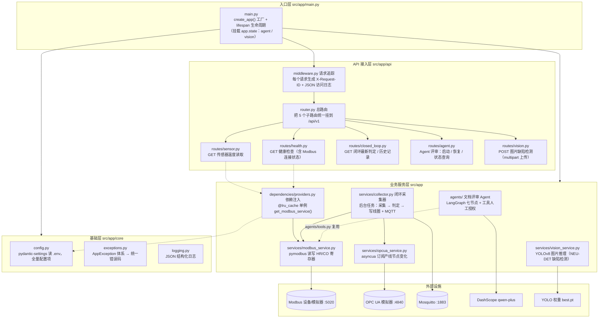
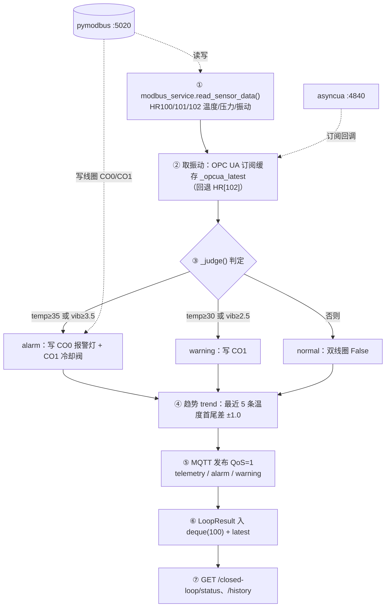
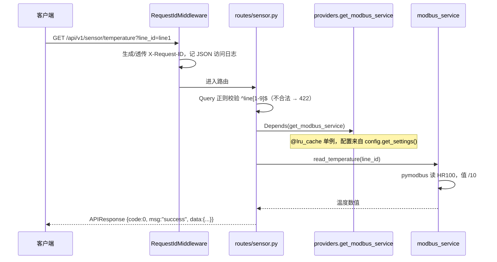
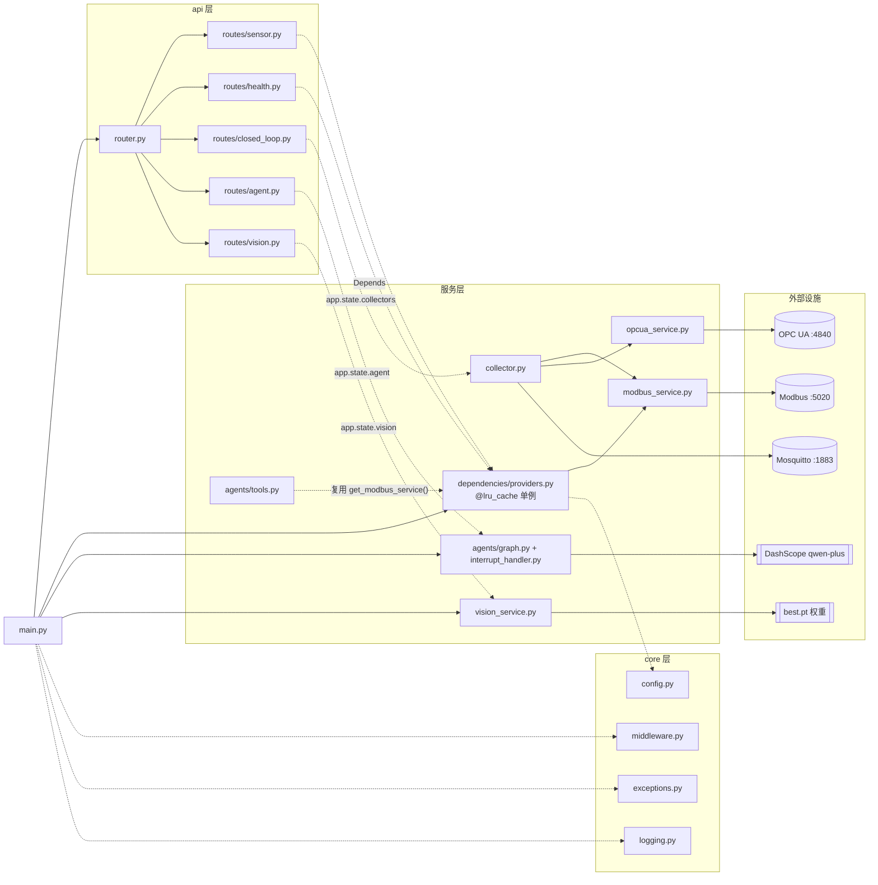
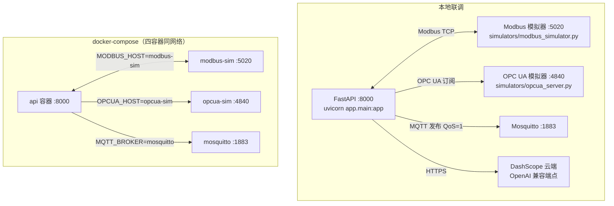

# 架构总览（新手导读）

本文档用「图 + 谁在哪 + 先看什么」帮你在 30 分钟内看懂这个项目的结构。配置项、启动命令、测试等细节见根目录 [README.md](../README.md)，两者互相链接、互不重复。

**图例约定**（所有图通用）：

- `──►` 实线：运行时调用或协议连接（进程之间真的有数据流动）
- `-.->` 虚线：代码级依赖（import、`Depends()` 注入、`app.state` 挂载）
- `硬依赖 / 软依赖`：外部设施没启动时，服务是「起不来」还是「只告警继续跑」

---

## 1. 总体架构分层图

一张图看懂分层：请求从上往下走，数据从下往上流。



> 缩放提示：GitHub 渲染的 mermaid 不支持自由缩放；把代码块内容粘贴到 [mermaid.live](https://mermaid.live) 或用 VS Code 的 Mermaid 预览插件打开，即可放大查看。

要点：

- 所有路由的**响应格式统一**为 `{code, msg, data}`；异常统一走 `exceptions.py` 体系
- `providers.py` 是依赖注入枢纽：路由层不直接 new 服务，而是 `Depends(get_modbus_service)` 拿单例
- `agents/tools.py` 里的工业工具与 HTTP 路由**复用同一个** `get_modbus_service()` 单例——Agent 读的传感数据和路由读的是同一条 Modbus 连接

---

## 2. 服务启动依赖：先起谁，服务才能起来

**这张图讲什么**：哪些外部设施必须在 `uvicorn` 之前启动，哪些可以后置；没启动会怎样。

```text
【启动顺序】先起 ① ② ③，再起 ④；⑤⑥ 为服务自身的启动前置

┌────────────────────────────────┐
│ ① Modbus TCP 模拟器            │ :5020
│    温度/压力/振动 寄存器动态变化 │
└───────────────┬────────────────┘
                │ 硬依赖：lifespan 里 connect()
                │ 失败 → DeviceOfflineError → 服务起不来
┌───────────────▼────────────────┐
│ ② OPC UA 服务器模拟器          │ :4840
│    ProductionLine 节点树       │
└───────────────┬────────────────┘
                │ 闭环硬依赖：重试 10 次 × 2s
                │ 失败 → RuntimeError
┌───────────────▼────────────────┐
│ ③ Mosquitto MQTT Broker       │ :1883
└───────────────┬────────────────┘
                │ 软依赖：连接失败仅记录告警
┌───────────────▼────────────────┐
│ ④ FastAPI 服务                │ :8000
│    uvicorn app.main:app        │
└────────────────────────────────┘
     │
     ├─ ⑤ YOLO 权重 best.pt ……… 硬依赖：缺失 → create_app 失败
     └─ ⑥ DASHSCOPE_API_KEY …… Agent 运行时依赖：评审时才用到
```

**依赖级别对照表**：

| 依赖项 | 级别 | 失败后果 | 代码位置 |
| --- | --- | --- | --- |
| Modbus 模拟器/设备 `:5020` | **硬** | `DeviceOfflineError`，服务启动失败 | `main.py` lifespan → `get_modbus_service().connect()` |
| OPC UA 模拟器 `:4840` | **硬**（仅闭环） | 重试 10 次 × 2s 后抛 `RuntimeError` | `services/collector.py`；注意 collector 启动代码当前在 `main.py` 中被注释，闭环默认未启用 |
| Mosquitto `:1883` | 软 | 仅记录告警，闭环继续跑 | `services/collector.py` 中 paho 连接 |
| YOLO 权重 `runs/detect/neu_det/weights/best.pt` | **硬** | `create_app()` 直接失败，服务起不来 | `services/vision_service.py`，`create_app()` 中 `app.state.vision = VisionService()` |
| `DASHSCOPE_API_KEY` | 运行时 | Agent 评审时 LLM 调用失败，不影响启动 | `agents/llm.py`（`os.getenv` 读取，不经 settings 类） |

> 启动命令与配置项详见 README「快速开始」与「配置项说明」。

---

## 3. 闭环数据流（核心业务链路）

**这张图讲什么**：`ClosedLoopCollector` 每 2 秒一轮的完整内部流程——从读寄存器到写线圈、发 MQTT、进历史缓存。

```text
                ┌──────────────────────────────────────────────────┐
 pymodbus 从站  │  ClosedLoopCollector（后台任务，每 2s 一轮）        │
 :5020 ◄───────►│                                                  │
  Modbus TCP    │  ① read_sensor_data()                            │
                │     一次读 HR100/101/102                          │
                │     温度 / 压力 / 振动                             │
                │                                                  │
 asyncua 服务器 │  ② 振动值优先取 OPC UA 订阅缓存 _opcua_latest      │
 :4840 ────────►│     （无订阅数据 → 回退寄存器 HR[102]）             │
  OPC UA 订阅   │                                                  │
                │  ③ _judge() 阈值判定                              │
                │     temp≥35 或 vib≥3.5 → alarm   写 CO0+CO1       │
                │     temp≥30 或 vib≥2.5 → warning 写 CO1           │
                │     否则 normal                  双线圈写 False    │
                │                                                  │
                │  ④ 趋势 trend：最近 5 条温度首尾差 ≥±1.0          │
                │                                                  │
                │  ⑤ 输出层：写线圈 + MQTT 发布（QoS=1）             │
                │     {prefix}/line1/telemetry                     │
                │     {prefix}/line1/alarm  {prefix}/line1/warning │
                └────────────────────────┬─────────────────────────┘
                                         │ ⑥ LoopResult 入库
                                 ┌───────▼────────┐
                                 │ deque(100) 缓存 │
                                 │ latest 最新一条  │
                                 └───────┬────────┘
                                         │ ⑦ 对外查询
                     GET /api/v1/closed-loop/status
                     GET /api/v1/closed-loop/history?limit=N
```

mermaid 版（同一件事，便于渲染查看）：



---

## 4. 一次 HTTP 请求的代码走向

**这张图讲什么**：以 `GET /api/v1/sensor/temperature?line_id=line1` 为例，一个请求穿过哪些代码、异常走哪里。



异常三分支（均在 `main.py` 注册处理器，返回统一的 `{code, message, data}`）：

| 异常 | 来源 | HTTP 状态码 |
| --- | --- | --- |
| `AppException` 子类（如 `DeviceOfflineError`） | 业务/服务层主动抛出 | 按 `status_code`（如 503） |
| `RequestValidationError` | Query/Body 校验失败（正则 `^line[1-9]$` 等） | 422 `VALIDATION_ERROR` |
| 其他未预期异常 | 任意位置 | 500 `INTERNAL_ERROR` |

---

## 5. 模块 / 服务依赖图

**这张图讲什么**：谁 import 谁、谁注入谁；5 个路由各自通过什么方式拿到业务对象。



关键约定：

- **`Depends()` 注入**：sensor / health 路由（同步读取型）
- **`app.state` 挂载**：closed_loop（`app.state.collector`）、agent（`app.state.agent`，lifespan 中 `build_graph(InMemorySaver())` 编译产物）、vision（`app.state.vision`，`create_app()` 中创建）
- `agents/` 内部结构：`state.py`（ReviewState）→ `graph.py`（StateGraph 七节点）→ `nodes.py`（节点实现）→ `routing.py`（条件边）→ `tools.py`（工业工具）→ `llm.py`（qwen-plus）→ `interrupt_handler.py`（中断提取与 resume 构造）

---

## 6. 运行与部署拓扑

**这张图讲什么**：本地联调与 docker-compose 两种跑法下，各进程/容器的端口与协议连线。



- 本地联调时各模拟器用 `python src/app/simulators/xxx.py` 启动，API 直连 `localhost` 各端口
- compose 下容器间走**网络内部端口**直连（通过 `MODBUS_HOST=modbus-sim` 等环境变量解析服务名）；`ports` 映射仅用于宿主机访问
- compose 的 `api` 容器当前未声明 `DASHSCOPE_API_KEY`，用 Agent 评审需自行注入

---

## 7. 新手阅读顺序指南

按下面的顺序读代码，每一步都有明确的「看完应该明白什么」：

| 顺序 | 文件 | 看完应该明白 |
| --- | --- | --- |
| 1 | `src/app/main.py` | 应用怎么组装：工厂 + lifespan、三个 `app.state` 挂载点、异常处理器注册 |
| 2 | `src/app/api/router.py` + `routes/sensor.py` | 一个最简单路由的完整样子：前缀、校验、`APIResponse` 包装 |
| 3 | `src/app/dependencies/providers.py` | 依赖注入怎么做：`@lru_cache` 单例 + `get_settings()` |
| 4 | `src/app/services/modbus_service.py` | 最底层硬件封装：HR/CO 地址表、`/10` 换算、连接管理 |
| 5 | `src/app/core/` 四件套（config / exceptions / middleware / logging） | 配置从 `.env` 怎么进来、异常体系、请求追踪、日志格式 |
| 6 | `src/app/services/collector.py` | 核心业务闭环：第 3 节那张图对应的真实代码（判定 → 写线圈 → MQTT） |
| 7 | `src/app/agents/`（state → graph → nodes → routing → tools → interrupt_handler） | LangGraph 图怎么搭：七节点、两类中断、resume 值怎么构造 |
| 8 | `src/app/services/vision_service.py` + `src/app/vision/train_neu_det.py` | YOLOv8 推理封装与训练脚本、权重路径约定 |
| 9 | `tests/` | 测试怎么写：`FakeModbus`/`FakeOpcUa` 替身、`asyncio_mode = "auto"` |
| 10 | `front/` | 前端工程（Vue 3 + Vite + Element Plus），详见 [front/README.md](../front/README.md) |

---

## 8. 业务入口速查表

| HTTP 端点 | 路由文件 | 背后的服务 | app.state 挂载 | 依赖的外部设施 |
| --- | --- | --- | --- | --- |
| `GET /api/v1/sensor/*` | `routes/sensor.py` | `modbus_service` | —（Depends 注入） | Modbus `:5020` |
| `GET /api/v1/health` | `routes/health.py` | `modbus_service` | —（Depends 注入） | Modbus `:5020` |
| `GET /api/v1/closed-loop/status` / `history` | `routes/closed_loop.py` | `collector` | `app.state.collector` | Modbus `:5020`、OPC UA `:4840`、MQTT `:1883` |
| `POST /api/v1/agent/review`（及 /resume、/status） | `routes/agent.py` | `agents/graph.py` + `interrupt_handler.py` | `app.state.agent` | DashScope qwen-plus、Modbus（工具读取） |
| `POST /api/v1/vision/neu-det/detect` | `routes/vision.py` | `vision_service` | `app.state.vision` | `runs/detect/neu_det/weights/best.pt` |
